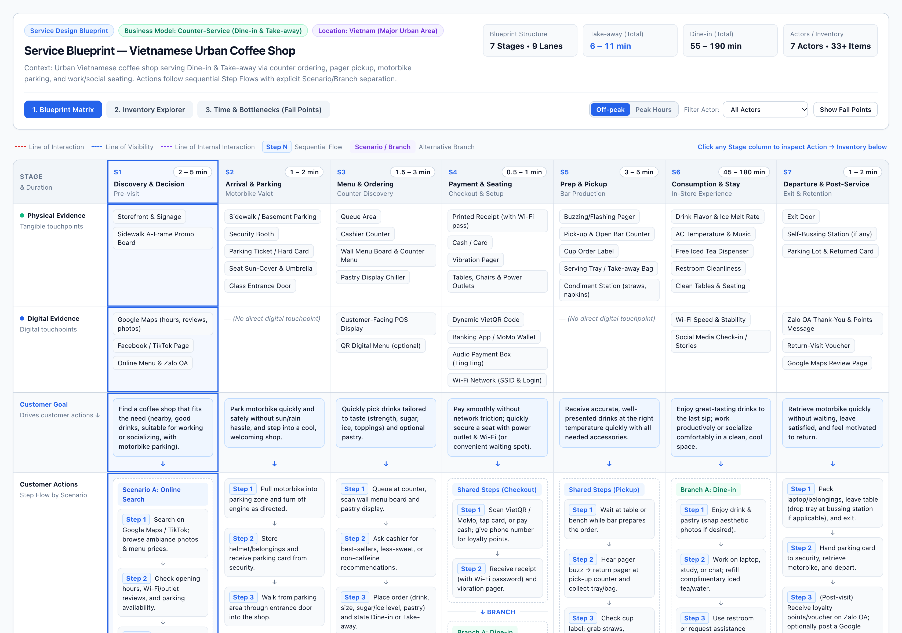

# Service Blueprint Brainstorm Skill

[](https://github.com/QuangHo0911/service-blueprint-brainstorm/releases/tag/v1.0.0)
[](./LICENSE)
[](#installation)

**English** | [Tiếng Việt](./README.vi.md)

> Turn any AI coding agent into a structured **Service Design partner**. Brainstorm end-to-end **Service Blueprints** through a rigorous **10-step framework** and export a **100% self-contained, Light-Theme interactive HTML blueprint** you can open in any browser or share with your team.

---

## Demo Output

> **Example:** Vietnamese Urban Coffee Shop — Counter-Service (Dine-in & Take-away)  
> Download or open the standalone interactive HTML: [`examples/service-blueprint-cafe-vn-en.html`](./examples/service-blueprint-cafe-vn-en.html)



---

## Why This Skill?

When you ask an AI to *"design a service blueprint"*, you usually get:
- Generic text tables that blur different business models together.
- Separate customer scenarios (e.g., *online discovery* vs. *walk-in*) mistakenly chained into a single linear flow.
- Missing local context (parking, payment habits, peak-hour bottlenecks) and missing backstage inventory.
- Plain markdown that is hard to present or review with stakeholders.

**`service-blueprint-brainstorm` fixes this** by enforcing a disciplined **10-step thinking process** and rendering a **portable HTML artifact** with zero external dependencies (no CDN, no host CSS variables — looks identical in Chrome, Safari, VS Code, Cursor, or Antigravity).

---

## The 10-Step Framework

| Step | Focus | What It Locks Down |
| :---: | :--- | :--- |
| **1** | **Business Model** | Counter-service, Take-away, Table-service, SaaS, Clinic, Marketplace, O2O... |
| **2** | **Location & Local Context** | Geography & local realities (e.g., Vietnam motorbike parking, VietQR, Zalo OA vs. Global/US) |
| **3** | **Actors** | Customers, Frontstage staff, Backstage staff, Systems & External partners |
| **4** | **Customer Goals** | Functional & emotional goals placed directly **above** Customer Actions (`Goal ↓ Actions`) |
| **5** | **Touchpoints (Evidence)** | Strictly separated **`Physical Evidence`** and **`Digital Evidence`** rows (unified neutral styling) |
| **6** | **Service Layering** | Three classic blueprint boundaries: `Line of Interaction`, `Line of Visibility`, `Line of Internal Interaction` |
| **7** | **Action Step Flows** | Sequential `Step 1 ↓ Step 2...` with explicit **`Scenario / Branch`** splits (`OR` / `↓ branch`) |
| **8** | **Touchpoint Durations** | **Off-peak vs. Peak** time estimates to expose real operational **Bottlenecks & Fail Points** |
| **9** | **Support Processes** | POS/IT, Supply Chain, QA/SOP, Facility, CRM/Loyalty, HR scheduling |
| **10** | **Inventory Mapping** | Reverse-mapped `Actor → Action → Required Inventory Item` (including invisible backstage supplies) |

### What the Interactive HTML Output Includes
1. **Blueprint Matrix:** Full 9-lane horizontal matrix with clickable stages, **Off-peak / Peak** toggle, **Actor filter**, **Fail Point highlighter**, and a **Stage Detail Inspector**.
2. **Inventory Explorer:** Searchable, filterable catalog of all consumables, equipment, space assets, and IT infrastructure mapped to Actors & Actions.
3. **Time & Bottlenecks:** Visual Off-peak vs. Peak duration comparison bars and actionable design mitigations.

---

## Installation

### 1. Claude Code
```bash
/plugin marketplace add QuangHo0911/service-blueprint-brainstorm
/plugin install service-blueprint-brainstorm@quangho-skills
```

### 2. OpenAI Codex
```bash
$skill-installer https://github.com/QuangHo0911/service-blueprint-brainstorm/tree/main/skills/service-blueprint-brainstorm
```

### 3. Cursor
1. Open **Cursor Settings → Customize → Plugins / Skills → Add from GitHub Repository**
2. Paste: `https://github.com/QuangHo0911/service-blueprint-brainstorm`

### 4. Gemini CLI
```bash
gemini extensions install https://github.com/QuangHo0911/service-blueprint-brainstorm
```

### 5. Antigravity
```bash
agy plugin install https://github.com/QuangHo0911/service-blueprint-brainstorm
```

### 6. Universal CLI (`skills.sh`)
```bash
npx skills add QuangHo0911/service-blueprint-brainstorm
```

---

## How to Prompt

### Mode 1 — Interactive Co-Brainstorm (Step-by-Step)
Use when you are still shaping the service and want the agent to guide you through 4 checkpoints before exporting HTML:
```text
Use service-blueprint-brainstorm to co-brainstorm a Service Blueprint step by step for [your product or service].
Once we finalize all 10 steps, export the standalone Light-Theme HTML file.
```

### Mode 2 — One-Shot Blueprint Generation
Use when you already know your business model and location and want the HTML immediately:
```text
Use service-blueprint-brainstorm to design and export a standalone Light-Theme HTML Service Blueprint:
- Product / Service: [e.g., Dental Clinic]
- Business Model: [e.g., Appointment-based + Walk-in]
- Location: [e.g., District 1, Ho Chi Minh City, Vietnam]
- Key Branches: [e.g., Routine Cleaning vs. Orthodontic Follow-up]
```

---

## Repository Structure

```text
service-blueprint-brainstorm/
├── README.md / README.vi.md
├── LICENSE                                         # MIT License
├── plugin.json                                     # Antigravity plugin manifest
├── gemini-extension.json                           # Gemini CLI extension manifest
├── .claude-plugin/                                 # Claude Code plugin & marketplace manifests
├── .cursor-plugin/                                 # Cursor plugin manifest
├── docs/demo-service-blueprint-en.png              # Demo screenshot
├── examples/service-blueprint-cafe-vn-en.html      # Standalone interactive HTML demo
└── skills/service-blueprint-brainstorm/
    ├── SKILL.md                                    # 10-step Agent Skill instructions
    ├── resources/blueprint-template.html           # Zero-CDN Light-Theme HTML template
    ├── scripts/render_blueprint.py                 # JSON validator & HTML renderer
    └── references/design-rules-and-schema.md       # Evidence vs. Inventory rules & JSON schema
```

## License

Released under the [MIT License](./LICENSE). Feel free to use, adapt, and share for personal or commercial projects.
