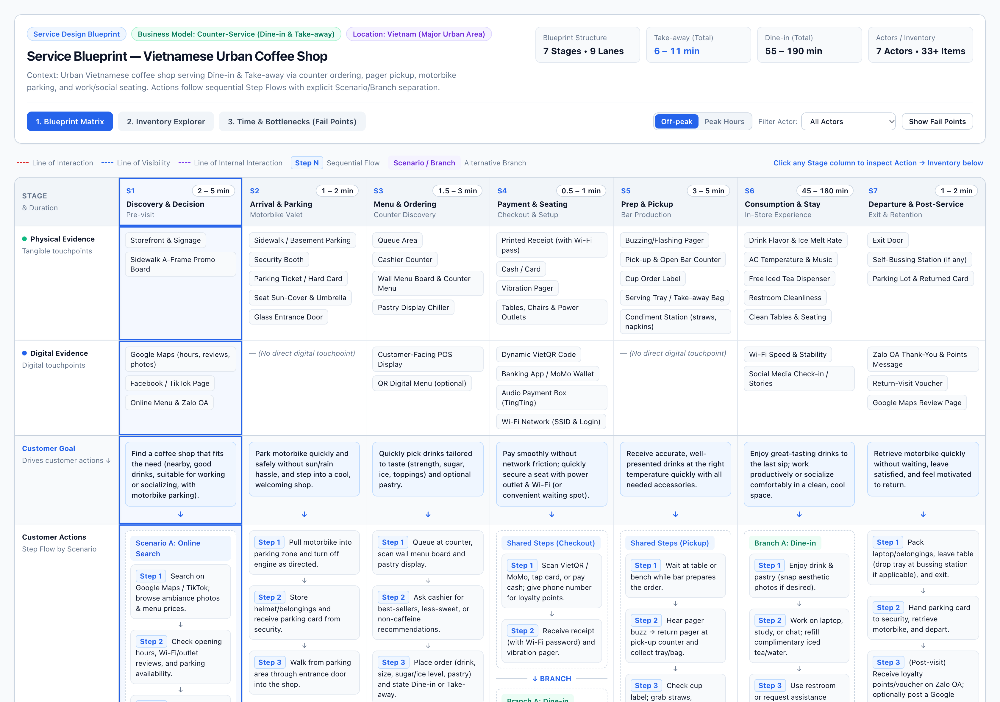

# Service Blueprint Brainstorm Skill

[](https://github.com/QuangHo0911/service-blueprint-brainstorm/releases/tag/v1.0.0)
[](./LICENSE)
[](#cài-đặt)

[English](./README.md) | **Tiếng Việt**

> Biến AI Agent thành **đối tác Service Design** có cấu trúc. Dẫn dắt brainstorm **Service Blueprint** chặt chẽ qua **10 bước tư duy** và xuất ra **file HTML tương tác Light Theme hoàn toàn độc lập** — mở trực tiếp trên mọi trình duyệt hoặc gửi đồng đội xem ngay mà không bị vỡ định dạng.

---

## Demo Đầu Ra

> **Ví dụ mẫu:** Quán cafe đô thị Việt Nam — Mô hình Counter-Service (Tại chỗ & Mang đi)  
> Tải hoặc mở trực tiếp file HTML tương tác: [`examples/service-blueprint-cafe-vn-en.html`](./examples/service-blueprint-cafe-vn-en.html)



---

## Vì sao nên dùng Skill này?

Khi nhờ AI vẽ Service Blueprint theo cách thông thường, kết quả hay gặp các lỗi sau:
- Trả lời chung chung, trộn lẫn nhiều mô hình kinh doanh khác nhau (ví dụ: order tại quầy vs. phục vụ tại bàn).
- Gộp hai kịch bản độc lập (ví dụ: *tìm quán online* và *khách vãng lai đi ngang qua*) thành các bước nối tiếp trong cùng một luồng.
- Bỏ sót bối cảnh bản địa (gửi xe máy, thanh toán VietQR, tắc nghẽn giờ cao điểm) và vật tư vận hành hậu trường.
- Chỉ trả về bảng chữ Markdown khó trình bày cho đội ngũ hoặc khách hàng.

**`service-blueprint-brainstorm` giải quyết các vấn đề này** bằng khung tư duy **10 bước kỷ luật** và tự động sinh **file HTML độc lập** (không dùng CDN ngoài, không phụ thuộc biến giao diện của IDE — hiển thị đồng nhất trên Chrome, Safari, VS Code, Cursor và Antigravity).

---

## Khung Tư Duy 10 Bước

| Bước | Trọng tâm | Nội dung cần chốt |
| :---: | :--- | :--- |
| **1** | **Business Model** | Counter-service, Take-away, Table-service, SaaS, Phòng khám, Marketplace, O2O... |
| **2** | **Địa điểm & Bối cảnh** | Phạm vi địa lý và đặc thù bản địa (VD Việt Nam: gửi xe máy, VietQR, Zalo OA vs. Global) |
| **3** | **Actors** | Khách hàng, nhân sự Frontstage, nhân sự Backstage, hệ thống IT và đối tác ngoài |
| **4** | **Customer Goals** | Mục tiêu chức năng & cảm xúc đặt **ngay phía trên** Customer Actions (`Goal ↓ Actions`) |
| **5** | **Touchpoints (Evidence)** | Tách riêng 2 hàng **`Physical Evidence`** và **`Digital Evidence`** (đồng bộ chip màu trung tính) |
| **6** | **Phân tầng dịch vụ** | 3 đường ranh giới chuẩn: `Line of Interaction`, `Line of Visibility`, `Line of Internal Interaction` |
| **7** | **Action Step Flows** | Viết tuần tự `Step 1 ↓ Step 2...`, tách bạch từng **`Scenario / Nhánh`** (`hoặc` / `↓ rẽ nhánh`) |
| **8** | **Thời lượng điểm chạm** | So sánh **Giờ thường vs. Giờ cao điểm** để lộ rõ **Bottlenecks & Fail Points** |
| **9** | **Support Processes** | Hệ thống POS/IT, Chuỗi cung ứng, QA/SOP, Hạ tầng, CRM/Loyalty, Xếp ca nhân sự |
| **10** | **Inventory Mapping** | Truy ngược `Actor → Action → Vật tư Inventory cần có` (gồm cả vật tư hậu trường khách không thấy) |

### File HTML đầu ra gồm 3 góc nhìn tương tác
1. **Blueprint Matrix:** Ma trận 9 hàng đầy đủ, có nút chuyển **Giờ thường / Cao điểm**, **lọc theo Actor**, bật **Fail Points**, và bảng **Chi tiết Giai đoạn** khi nhấn vào từng cột.
2. **Inventory Explorer:** Bảng danh mục vật tư/thiết bị có ô tìm kiếm và bộ lọc theo Phân loại & Actor.
3. **Thời gian & Điểm nghẽn:** Biểu đồ so sánh thời lượng vận hành và danh sách giải pháp xử lý rủi ro.

---

## Cài đặt

### 1. Claude Code
```bash
/plugin marketplace add QuangHo0911/service-blueprint-brainstorm
/plugin install service-blueprint-brainstorm@quangho-skills
```

### 2. OpenAI Codex
```bash
$skill-installer https://github.com/QuangHo0911/service-blueprint-brainstorm/tree/main/skills/service-blueprint-brainstorm
```

### 3. Cursor
1. Mở **Cursor Settings → Customize → Plugins / Skills → Add from GitHub Repository**
2. Dán URL: `https://github.com/QuangHo0911/service-blueprint-brainstorm`

### 4. Gemini CLI
```bash
gemini extensions install https://github.com/QuangHo0911/service-blueprint-brainstorm
```

### 5. Antigravity
```bash
agy plugin install https://github.com/QuangHo0911/service-blueprint-brainstorm
```

### 6. Cài nhanh đa nền tảng (`skills.sh`)
```bash
npx skills add QuangHo0911/service-blueprint-brainstorm
```

---

## Cách Prompt để ra đúng Output

### Chế độ 1 — Co-Brainstorm từng bước cùng AI
Dùng khi bạn mới có ý tưởng, muốn AI dẫn dắt chốt lần lượt 4 chặng trước khi xuất HTML:
```text
Dùng skill service-blueprint-brainstorm để cùng mình brainstorm từng bước và thiết kế Service Blueprint cho [tên sản phẩm / dịch vụ].
Sau khi chốt xong 10 bước, xuất ra file HTML standalone (Light Theme).
```

### Chế độ 2 — Xuất thẳng file HTML (One-Shot)
Dùng khi bạn đã chốt sẵn mô hình kinh doanh & địa điểm:
```text
Dùng skill service-blueprint-brainstorm thiết kế và xuất luôn file HTML Service Blueprint với bối cảnh:
- Sản phẩm / Dịch vụ: [VD: Phòng khám nha khoa]
- Business model: [VD: Đặt lịch trước kết hợp khách vãng lai]
- Địa điểm: [VD: Quận 1, TP. Hồ Chí Minh]
- Nhánh chính: [VD: Khám tổng quát vs. Tái khám niềng răng]
```

---

## Giấy phép

Phát hành theo [Giấy phép MIT](./LICENSE) — thoải mái sử dụng, tùy chỉnh và chia sẻ cho cả dự án cá nhân lẫn thương mại.
